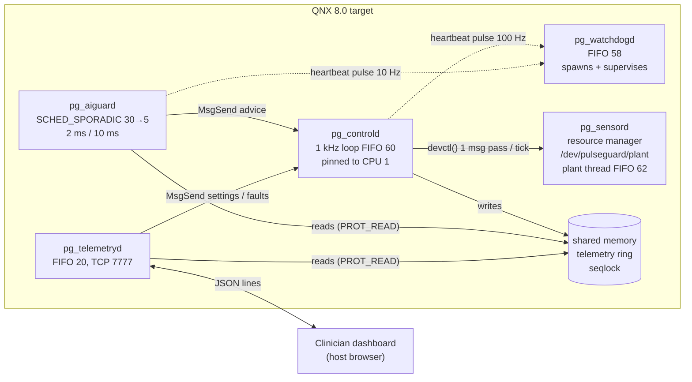

# PulseGuard

**A mixed-criticality ventilator controller on QNX 8.0. The AI may advise, but the operating system decides whether it can ever hurt the patient.**

[](https://github.com/abhisuman2001/pulseguard/actions/workflows/ci.yml)
QNX 8.0 · x86_64 (QEMU) and aarch64le · C11 · Apache-2.0 · Category: **Robotics & Medical**

Medical devices are adding AI quickly: waveform classifiers, closed-loop suggestions, "smart" alarms. The hard question is not whether the model is accurate. It is this: what happens to the patient when the model is wrong, slow, hung, or malicious? PulseGuard answers with architecture instead of hope. A 1 kHz pressure-control ventilation loop runs as a hard real-time process. An AI respiratory-mechanics advisor runs next to it, fenced in by QNX's scheduler, memory protection, and message-passing contracts. In the demo we try to break it four different ways, live.

<!-- TODO: screenshot of the dashboard connected to the real QNX target: docs/img/dashboard.png -->
<!--  -->

---

## What it does

- **Ventilates a simulated patient** using pressure-controlled ventilation (PIP, PEEP, rate and I:E ratio), with a PI pressure loop at **1 kHz**.
- **Simulates the hardware** behind a real QNX **resource manager** at `/dev/pulseguard/plant`. The sensors and blower are a single-compartment lung model. Replacing it with real I²C/PWM drivers requires *no* change to the controller.
- **Diagnoses the lung in real time.** For every breath, a least-squares fit estimates airway **resistance (R)** and **compliance (C)**. A trained classifier then detects *leak, occlusion, stiff lung (ARDS-like), and disconnect* (95.2% held-out accuracy, reproducible from source).
- **Proposes, never commands.** AI setting changes pass the same hard safety envelope as the clinician's, are step-limited, and take effect only after a clinician clicks *Accept*.
- **Survives attacks you can trigger from the dashboard:**

| Attack (dashboard button) | What QNX does | What the patient sees |
|---|---|---|
| **CPU stress**: FIFO priority 55 busy loops on every core except 0, *including the control loop's own core* | Priority preemption plus a runmask-pinned control thread | Control jitter unchanged (see [results](#results)) |
| **Rogue AI**: the model spins forever and emits lethal proposals (PIP 80, NaN rate) | `SCHED_SPORADIC` budget exhausted, so the kernel demotes the thread to priority 5. Proposals are clamped and rejected. The watchdog kills and restarts the advisor | Nothing. Ventilation continues |
| **Kill controller**: the control process aborts | Heartbeat pulses stop, `watchdogd` detects the loss within 50 ms, and `posix_spawn` starts a new controller that restores settings from shared memory | The plant's independent fail-safe opens the valve during the gap. Ventilation resumes in tens of ms |
| **Patient faults**: leak, occlusion, stiff lung, disconnect | Alarms evaluated every 1 ms tick. Over-pressure dumps within **one tick** | Alarm bar plus AI diagnosis and suggested correction |

## Architecture



**Criticality levels**

| Level | Component | Guarantee |
|---|---|---|
| Safety-critical | `pg_sensord` plant thread, `pg_controld` control thread | Highest FIFO priorities, pinned core, locked memory, no heap or blocking in loop, independent hardware fail-safe |
| Supervision | `pg_watchdogd` | Heartbeat pulses with a 50 ms timeout, automatic restart, measured recovery |
| Advisory (AI) | `pg_aiguard` | CPU budget enforced by the **kernel**, read-only data, can only *propose* through a validating server |
| Best-effort | `pg_telemetryd`, dashboard | Can fail or lag without consequence |

## QNX evidence map

Every claim above maps to code that only makes sense on QNX:

| QNX feature | Where | Why it matters here |
|---|---|---|
| **Resource manager** (`resmgr_attach`, `iofunc_*`, custom `io_devctl`, `io_read`) | [`src/sensord/sensord.c`](src/sensord/sensord.c) `main`, `io_devctl`, `io_read` | Hardware is a path name. A real driver can replace the simulation transparently. `cat /dev/pulseguard/plant` works |
| **devctl() with `__DIOTF`**: command in, sample out, in *one* message pass | [`include/pg_devctl.h`](include/pg_devctl.h), `control_thread` in [`controld.c`](src/controld/controld.c) | Minimal I/O latency per control tick |
| **Priority inheritance through message passing** | resource manager server thread in `sensord.c`, `controld.c` server loop | A low-priority client's request is served at *its* priority, so the AI or telemetry can never delay the control loop by sending messages |
| **Timer → pulse delivery** (`timer_create` + `SIGEV_PULSE_INIT`, `MsgReceivePulse`) | [`src/common/pg_rt.c`](src/common/pg_rt.c) `pg_periodic_start/wait` | Deterministic 1 kHz wake-ups with no signals |
| **Runmask CPU pinning** (`ThreadCtl(_NTO_TCTL_RUNMASK)`) | `pg_pin_cpu` in `pg_rt.c`, `stressor.c` | The control loop owns its core's cache and never migrates |
| **`ClockCycles()` + `SYSPAGE_ENTRY(qtime)->cycles_per_sec`** | `pg_cycles*` in `pg_rt.c` | Sub-microsecond jitter measurement of every tick |
| **`SCHED_SPORADIC`** (`sched_ss_low_priority`, `sched_ss_init_budget`, `sched_ss_repl_period`) | `main` in [`src/aiguard/aiguard.c`](src/aiguard/aiguard.c) | Kernel-enforced CPU budget for the AI, the QNX 8.0 answer to "what if the model runs away" |
| **`sched_curpriority`** (effective priority readback) | `rogue_mode` in `aiguard.c` | The AI *observes* itself being demoted, and the dashboard shows it |
| **Per-thread CPU-time clock** (`pthread_getcpuclockid`) | `thread_cpu_ns` in `aiguard.c` | AI CPU consumption is measured, not guessed |
| **`name_attach` / `name_open` / `MsgSend` / `MsgReply` / `MsgError`** | `controld.c`, `aiguard.c`, `watchdogd.c`, `telemetryd.c` | Synchronous, validated, typed IPC between all components, with `_PULSE_CODE_DISCONNECT` handling |
| **Pulses as heartbeats** (`MsgSendPulse`) | `control_thread`, `advisor_thread` → `watchdogd.c` | Non-blocking liveness signals the sender can't get stuck on |
| **`procmgr_ability()`**: deny and lock `SPAWN` / `FORK` | `pg_drop_abilities` in `pg_rt.c` | Least privilege: a compromised controller or AI cannot start processes |
| **`posix_spawn` supervision** | `spawn_child`, `restart_child` in [`watchdogd.c`](src/watchdogd/watchdogd.c) | Process-level fault containment and restart, measured in ms |
| **`slog2`** structured logging | `pg_log_init`/`PG_LOG` in `pg_rt.c` | `slog2info` on the target shows the full event history |
| **`mlockall`**, `pidin`, `slay` | `pg_lock_memory`, [`target/pulseguard.sh`](target/pulseguard.sh) | No page faults in the RT path. Visible scheduling policy (`60f`, `30s`) in `pidin` |
| **`qcc -V gcc_ntox86_64` / `gcc_ntoaarch64le`**, `mkqnximage` | [`Makefile`](Makefile), [`scripts/qnx-vm.sh`](scripts/qnx-vm.sh) | Cross-built for QNX 8.0 and booted in a QNX QEMU image |

## Build and run

**Tested with:** QNX SDP 8.0 (QNX Everywhere, free non-commercial license) · target: **QEMU x86_64** built with `mkqnximage` · toolchain: **`qcc -V gcc_ntox86_64`** · host: Ubuntu 24.04 (native or WSL2). The code is architecture-neutral; `ARCH=aarch64le` builds for a Raspberry Pi 4.

```bash
# 0. once: install QNX SDP 8.0 via QNX Software Center, plus QEMU
sudo apt install qemu-system-x86 python3 make gcc
source ~/qnx800/qnxsdp-env.sh

# 1. host checks: unit tests for the safety core + protocol (no QNX needed)
make test

# 2. create and boot the QNX 8.0 VM
scripts/qnx-vm.sh create
scripts/qnx-vm.sh start            # prints the target IP

# 3. cross-compile, deploy, start PulseGuard, open the dashboard
scripts/deploy.sh                  # -> http://localhost:8080
```

On the target (`ssh root@<ip>`):

```sh
/data/pulseguard/pulseguard.sh status    # pidin view: 60f = FIFO 60, 30s = sporadic
cat /dev/pulseguard/plant                # read the "hardware" like a file
/data/pulseguard/pulseguard.sh log       # slog2info event stream
/data/pulseguard/rtbench -s 30 -l 7      # timing benchmark under load
```

**No QNX yet?** `scripts/dev-emulator.sh` runs the same portable core in a Linux process behind the same protocol, for UI work. The dashboard shows a banner, because the emulator is **not** real-time and **not** the product.

## Results

<!-- Filled from real runs on the QNX 8.0 target; see docs/RESULTS.md for the raw output -->

| Measurement (1 kHz loop, 30 s) | QNX 8.0 idle | QNX 8.0 + CPU stress | Linux (same host, same loop, `rtbench`) + stress |
|---|---|---|---|
| p99 wake-up lateness | _TBD_ | _TBD_ | _TBD_ |
| worst case | _TBD_ | _TBD_ | _TBD_ |
| deadline misses (>200 µs) | _TBD_ | _TBD_ | _TBD_ |

| Fault-tolerance measurement | Result |
|---|---|
| Controller kill → detection | _TBD_ ms (timeout 50 ms) |
| Detection → new controller's first heartbeat | _TBD_ ms |
| Rogue AI → demoted to prio 5 | _TBD_ |
| Over-pressure → valve open | ≤ 1 control tick (1 ms), unit-tested |

> QEMU timing depends on the host and on KVM. Absolute numbers on real hardware are better. The *relative* behaviour (QNX vs the same loop on a general-purpose OS on the same machine) is the point.

## The AI, and why it's small on purpose

- **Features (per breath):** least-squares fit of `Paw = R·Q + V/C + P0` (respiratory mechanics), leak fraction `(Vin−Vout)/Vin`, peak flow, mean pressure, tidal volume.
- **Model:** multinomial logistic regression, 6 features → 5 classes. Inference costs a few microseconds, which fits inside a 2 ms sporadic budget with a 100× margin.
- **Training data:** [`tools/simgen.c`](tools/simgen.c) runs *the same plant, controller and estimator code that runs on QNX* across randomised patients (C 40–90 mL/cmH₂O, R 4–18 cmH₂O/L/s, varied severities and settings). [`tools/train_model.py`](tools/train_model.py) (standard library only) trains it and writes [`core/pg_model_weights.h`](core/pg_model_weights.h). `make model` reproduces it bit for bit. CI does this on every push.
- **Held-out accuracy 95.2%**: leak 100%, disconnect 100%, occlusion 94%, stiff lung 94%, normal 88%.
- A bigger model could be swapped in. The scheduling fence doesn't care how smart the model is, which is the point.

## Safety design notes

- **One envelope for everyone** (`pg_settings_clamp`): PIP 8–35, PEEP 0–15, RR 6–35, I:E 1:1–1:4, PIP ≥ PEEP+5. NaN and infinity are rejected. Unit-tested.
- **AI proposals** are additionally step-limited (±2 cmH₂O, ±3 bpm per proposal), need confidence > 0.7, and require clinician acceptance. They are re-validated on accept.
- **Defence in depth:** the over-pressure dump is in the control loop, the plant has an independent fail-safe if commands stop for 20 ms, the watchdog restarts the controller, and settings persist across restarts.
- **Separation of software items by criticality** mirrors the segregation concept in IEC 62304 (software items of different safety classes must be demonstrably separated). QNX makes the separation *enforceable* rather than a convention.

**Not a medical device.** PulseGuard is a hackathon research prototype with a simulated patient. It has not been validated for clinical use.

## Repository layout

```
include/            shared protocol: messages, pulses, devctl codes, shm layout
core/               portable C11 core: lung model, controller, envelope, estimator, classifier, telemetry codec
src/sensord/        QNX resource manager: simulated ventilator hardware
src/controld/       QNX 1 kHz safety-critical control process
src/aiguard/        QNX AI advisor under SCHED_SPORADIC
src/watchdogd/      QNX supervisor / launcher
src/telemetryd/     QNX TCP bridge to the dashboard
src/stressor/       QNX hostile load generator (demo)
src/common/         QNX real-time helpers (pulses, runmask, ClockCycles, slog2, procmgr_ability)
host/dashboard/     clinician dashboard (Python stdlib bridge + single-page UI)
tools/              simgen + model training, rtbench, host emulator
tests/              host unit tests (safety core, protocol)
scripts/            mkqnximage VM, deploy, emulator
docs/codelab/       step-by-step tutorial: real-time control on QNX 8.0
```

## License

Apache-2.0. See [LICENSE](LICENSE).
